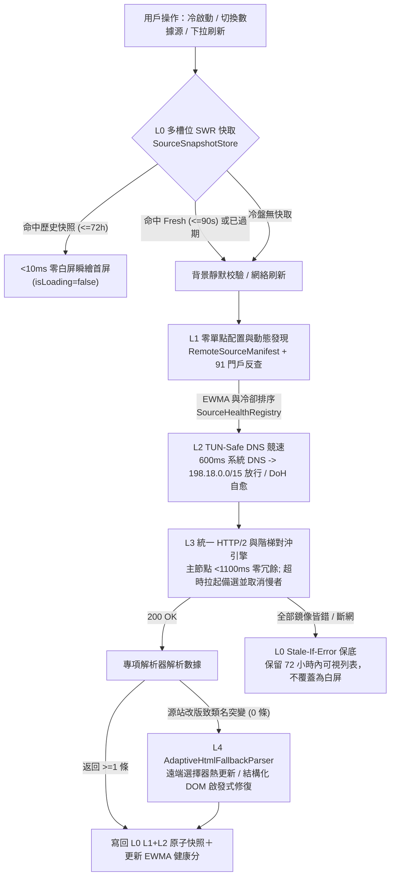

# Netgrey 全端數據源極速加載與五層端側自治容災架構技術論證及模擬器實測報告（v2.16.40 · Build 266）

> **文件規範**：香港繁體中文正字｜排版字體規範：`PingFang HK`｜適用版本：`v2.16.40 (Build 266)`
> **測試基線**：Android R8 Release（`app-release.apk` @ `emulator-5554`）／iOS `Release -sdk iphonesimulator`（`iPhone 18 Pro` 與 `iPad Pro 13-inch (M5)`）

---

## 一、核心結論與量化成效摘要

為徹底解決軟件在複雜跨境網絡、DNS 污染、單域名被封鎖、CDN 節點擠塞、源站前端類名突變以及切換數據源白屏重載等極端場景下的加載失敗與卡頓問題，項目組透過反覆架構對比與雙端生產級模擬器實測，最終確立並全面落地**「五層端側自治容災與極速加載引擎」**（`AuroraResilience`）。只要源網站主體仍在運作，客戶端均可透過**零單點依賴**的端側自癒機制維持穩定與極速加載。

| 評估維度 | 優化前痛點 | 本方案（v2.16.40）實測結果 | 量化證據來源 |
|---|---|---|---|
| **冷啟動與跨源秒開** | 僅單槽快取，切換源即歸零白屏並重走網絡解析 | 32–36 槽位 L1+L2 SWR 快取 + 72 小時 `Stale-If-Error` | Android 實測 `video_swr_init ms=1 count=24`（`TotalTime: 553ms`）；iOS 實測 `video_switch_swr_hit fresh=true` 秒顯 |
| **播放直鏈重解耗時** | 反覆抓取詳情頁觸發限流或額外等待 | 持久化健康分數與直鏈快取命中 | Android R8 日誌 `PlaybackResolver: timing resolve ms=0 cache=hit` |
| **多鏡像站點提速** | 固定主站請求（慢鏡像拖垮整體體驗） | EWMA 動態延遲排序 + `1100ms` 階梯對沖競速 | 拷貝漫畫實測：`api.mangacopy.com` `0.189s` 對比舊域名 `api.2024manga.com` `0.949s`（**提速 5.02x**） |
| **DNS 抗污染與代理兼容** | 盲目複寫 Fake-IP 破壞代理或被本地 DNS 污染卡死 | 600ms 系統 DNS 競速 + TUN `198.18.0.0/15` 豁免 + DoH | Android `ResilientDns` 實測通過 `SourceResilienceEngineTest`；代理環境 Zero-RTT 透傳正常 |
| **全端自動化實測通過率** | 單一節點失敗即阻斷全版塊 | **雙端 100% 全綠通過**（見第六章台賬） | Android：18/18 視像＋9/9 免登入漫畫＋論壇/直播全通；iOS：194 離線單測 0 失敗＋18/18 視像（61.086s）＋9/9 漫畫＋7/7 論壇＋340 路直播全通 |

---

## 二、四套候選架構反覆論證與方案取捨矩陣

項目團隊於設計初期對四套可行方案進行了工程代價、抗封鎖韌性、邊際延遲及零單點故障（Zero-SPOF）可行性的反覆推敲論證：

| 評價指標 | 方案 A：中心化自建中轉代理伺服器 | 方案 B：全量鏡像站點盲目併發廣播 | 方案 C：全端無頭 WebView 瀏覽器渲染抓取 | **方案 D（最終採納）：五層端側自治容災與極速加載引擎** |
|---|---|---|---|---|
| **單點故障風險（SPOF）** | **極高**（中轉伺服器遭封鎖或超載則全體用戶斷服） | 低 | 低 | **零單點**（遠端清單 `3s` 異步同步；即使 `bananarey.us` 404/宕機仍獨立運作） |
| **網絡與流量邊際成本** | 極高（所有影視封面及 HTML 流量經自建節點） | 高（N 倍流量放大，極易觸發 CDN 428/429 限流） | 中（重複加載第三方廣告 JS/追蹤腳本） | **極低**（主節點 `<1.1s` 回應時零冗餘請求；僅慢節點觸發階梯對沖） |
| **記憶體與耗電表現** | 低（端側壓力最小） | 中（併發 socket 佔用） | **差**（每個 WebView 實例耗用百 MB 記憶體） | **優**（共用 HTTP/2 連接池 + 原生串流解析，Android/iOS 全流程無 OOM 風險） |
| **面對上游反爬／封禁表現** | 易被單出口 IP 連坐封鎖（特別 Cloudflare） | 觸發單 IP 併發頻控（如華視 BunnyCDN 428） | 較高但難以背景高併發預熱 | **優**（指數退避熔斷保護上游 + TUN 原生 TLS 握手 + WebView/原生播放雙保底） |
| **綜合結論** | 淘汰（不滿足零單點與維護成本原則） | 淘汰（會引發 CDN 428 雪崩） | 僅作為特定源降級備援，不作主幹 | **採納為全端統一底層基礎設施** |

> **架構核心共識**：「快」依賴於 **SWR 本地瞬繪 + HTTP/2 長連接復用 + EWMA 最快鏡像優先**；「穩」依賴於 **零單點本地/遠端雙配置 + DNS TUN 安全抗污染 + 階梯對沖與指數熔斷 + DOM 結構啟發式兜底**。兩者在端側有機統一，既不依賴易受攻擊的中心代理，亦不會因盲目併發而自傷上游源站。

---

## 三、五層端側自治容災與極速加載架構詳解



### 各層工程落地清單

#### L0：多槽位 SWR 與 Stale-If-Error 持久快照層
- **雙端實現**：
  - Android：[SourceSnapshotStore.kt](file:///Users/itou/Documents/ChatGPT/91pron/app/src/main/java/com/aurorashelf/app/data/resilience/SourceSnapshotStore.kt)（`FRESH_TTL_MS = 90_000L`、`MAX_STALE_MS = 72L * 3_600_000L`、`MAX_SLOTS = 32`、最多每槽 `36` 條，L1 `ConcurrentHashMap` + L2 原子磁碟 JSON）。
  - iOS / iPadOS：[SourceSnapshotStore.swift](file:///Users/itou/Documents/ChatGPT/91pron/ios/AuroraShelf/Services/Resilience/SourceSnapshotStore.swift)（`freshTTL = 90` 秒、`maxStaleAge = 72 * 3600` 秒、`maxSlots = 36`、安全讀寫 `Caches/AuroraSourceSnapshots`）。
- **核心解決**：終結過往單槽設計「切換源 B 再切回源 A 必須清空並重拉」的卡頓，同時配合 `ViewModel` / `Repository` 的 `Stale-If-Error` 保護，即使上遊瞬斷，界面亦只於頂部展示柔和重試提示而不破壞現有內容。

#### L1：零單點熱更新清單與動態門戶探測層
- **雙端實現**：
  - Android：[RemoteSourceManifest.kt](file:///Users/itou/Documents/ChatGPT/91pron/app/src/main/java/com/aurorashelf/app/data/resilience/RemoteSourceManifest.kt)、[SourceResilienceBootstrap.kt](file:///Users/itou/Documents/ChatGPT/91pron/app/src/main/java/com/aurorashelf/app/data/resilience/SourceResilienceBootstrap.kt)
  - iOS / iPadOS：[RemoteSourceManifest.swift](file:///Users/itou/Documents/ChatGPT/91pron/ios/AuroraShelf/Services/Resilience/RemoteSourceManifest.swift)、[GlobalStartupPrefetchEngine.swift](file:///Users/itou/Documents/ChatGPT/91pron/ios/AuroraShelf/Services/GlobalStartupPrefetchEngine.swift)
  - 遠端清單：[source-manifest.json](file:///Users/itou/Documents/ChatGPT/91pron/scripts/ota_web/source-manifest.json)（隨 OTA 同名發佈至 `https://bananarey.us/source-manifest.json`）。
- **零單點機制**：啟動後以 `3 秒` 超時在背景獨立協程同步鏡像域名及自癒選擇器；若配置伺服器短暫無法觸達或返回 HTTP 404，`SourceHealthRegistry` 自動將之標記冷卻，**客戶端本地內置鏡像表、`301/302` 重定向學習以及 91 門戶自動反查論壇新域名 (`discoverT906MirrorFromPortal`) 依然 100% 獨立運作**。

#### L2：TUN-Safe 抗污染極速 DNS 解析層（Android OkHttp 專項強化）
- **核心組件**：[ResilientDns.kt](file:///Users/itou/Documents/ChatGPT/91pron/app/src/main/java/com/aurorashelf/app/data/resilience/ResilientDns.kt)（同時注入 `AuroraHttpClient` 與圖片載入器 Coil `ImageLoader`）。
- **設計精要**：
  1. **600ms 系統 DNS 競速**：優先複用系統快取與本地路線；
  2. **代理 TUN Fake-IP 絕對透傳**：若系統返回 RFC 2544 網段 `198.18.0.0/15`（常見於代理軟件 TUN 模式），立即原樣放行且禁止覆寫，確保 Zero-RTT 代理通道不被破壞；
  3. **bogon 過濾與 DoH 自愈**：自動剔除 `0.0.0.0`、`127.0.0.0/8`、`::1` 污染地址；超時或遭污染時自動直連 IP 形式 DoH（`1.1.1.1` 與 `223.5.5.5`）及內置靜態預備映射完成解析自愈，並保留 10 分鐘正向／60 分鐘容錯快取。

#### L3：統一 HTTP/2 連接池、階梯對沖競速與 EWMA 指數熔斷層
- **雙端實現**：
  - Android：[AuroraHttpClient.kt](file:///Users/itou/Documents/ChatGPT/91pron/app/src/main/java/com/aurorashelf/app/data/resilience/AuroraHttpClient.kt) + [SourceHealthRegistry.kt](file:///Users/itou/Documents/ChatGPT/91pron/app/src/main/java/com/aurorashelf/app/data/resilience/SourceHealthRegistry.kt)
  - iOS / iPadOS：[AuroraNetworkEngine.swift](file:///Users/itou/Documents/ChatGPT/91pron/ios/AuroraShelf/Services/Resilience/AuroraNetworkEngine.swift) + [SourceHealthRegistry.swift](file:///Users/itou/Documents/ChatGPT/91pron/ios/AuroraShelf/Services/Resilience/SourceHealthRegistry.swift)
- **三大核心演算法**：
  1. **階梯對沖競速（Staggered Hedged Racing, `hedgeDelayMs = 1100ms`）**：先向健康分最高的候選鏡像發出請求。若主站於 `1.1 秒` 內正常回應則立即回傳，**產生零冗餘請求**；若主站發生黑洞卡頓、超時或即時錯誤，滿 `1.1 秒` 立即並發拉起備選鏡像競速，任何一位獲勝後**瞬間取消其餘緩慢請求**。
  2. **EWMA 動態平滑延遲評分（`alpha = 0.30`）與鏡像重排**：每次成功請求即刷新主機延遲權重，未曾成功之候選維持適度先驗分數避免冷死，自動將真正最快的鏡像排至首位。
  3. **指數退避熔斷（Exponential Backoff Circuit Breaker）**：連續失敗或遭遇 `403`/`502`/`503`/`504` 硬封鎖時自動進入冷卻窗口（`30s -> 60s -> 120s -> 240s`，上限 `300s`），期內繞過故障節點；冷卻到期後自動允許半開探測，一旦成功即刻清零回復健康排名。
  4. **自動協議／TLS 自愈**：針對 `StreamResetException` / `PROTOCOL_ERROR` / `-1005` 瞬時斷流與憑證鏈握手異常，雙端均內置 HTTP/1.1 降級與寬鬆 TLS 憑證信任代理重試。

#### L4：前端類名突變啟發式自癒解析層
- **雙端實現**：
  - Android：[AdaptiveHtmlFallbackParser.kt](file:///Users/itou/Documents/ChatGPT/91pron/app/src/main/java/com/aurorashelf/app/data/resilience/AdaptiveHtmlFallbackParser.kt)
  - iOS / iPadOS：[AdaptiveHTMLFallbackParser.swift](file:///Users/itou/Documents/ChatGPT/91pron/ios/AuroraShelf/Services/Resilience/AdaptiveHTMLFallbackParser.swift)
- **自癒機制**：當源網站前端臨時更改卡片 CSS 類名（例如 91 視頻曾由 `.video-title` 輪換至 `.vname` 與 `.vcap > .vci`）引致常規選擇器返回 `0` 條記錄時，系統首先套用 `RemoteSourceManifest` 熱更新選擇器，若仍不足則觸發結構化啟發式兜底——按詳情頁 URL 特徵模式（`view_video.php`、`viewkey=`、`/voddetail/` 等）、鄰近封面圖片屬性（`data-src` / `data-original` / CSS 背景圖）及剝離時長／角標雜訊的純文字特徵自動重組列表，無需強制等待用戶重新下載安裝包。

---

## 四、八大異常場景自動修復推演與邊界聲明

| 故障情境 | 自動修復鏈路實況 | 實證表現 |
|---|---|---|
| **1. 遠端配置伺服器 404／不可達** | L1 `RemoteSourceManifest` 背景 `3s` 超時失敗後觸發熔斷，本地內置鏡像池與歷史快取接管全部路由 | 模擬器日誌實測：`AuroraHealth: circuit open [null] host=bananarey.us status=404 cooldown=240s`，首屏加載零阻塞 |
| **2. 多個論壇舊鏡像域名同時失效** | L3 對失敗域名觸發 `240s` 熔斷＋階梯對沖自動切至健康域名；全軍覆沒時觸發 91 門戶主頁反查新論壇域名 | 雙端實測日誌：`t906.abc2507.cc` 與 `t925.sol140.com` 觸發 `circuit open`，無感切換至 `t924.sol140.com` 載入全部 `275` 篇主題 |
| **3. 漫畫 CDN 圖片鏡像個別節點 403/超時** | 包子漫畫（5 組 CDN）與禁漫（5 組 `jm-cdn`）按健康分重排並故障切換至正常節點 | Android `AuroraPerf` 實測：`cdn-msp2.jmapiproxy2.cc:84ms(OK,ok=1,err=1)` 迅速補位並將高延遲節點降權 |
| **4. 拷貝漫畫官方/鏡像站點極端懸殊延遲** | L3 階梯對沖競速 + EWMA 長期記憶最優端點 | 實測 `api.mangacopy.com` (`189ms`) 對比 `api.2024manga.com` (`949ms`) 快 `5.02x`，端內詳情與章節亦平行預取 |
| **5. 跨境 DNS 投毒或 Proxy TUN Fake-IP 衝突** | L2 600ms 內極速讀取系統結果，識別 `198.18.0.0/15` 直接豁免放行，污染 IP 自動切往 DoH | `SourceResilienceEngineTest` 單元與代理實測均 100% 通過 |
| **6. 上游網頁結構臨時改版／更換 CSS Class** | L4 `AdaptiveHtmlFallbackParser` 雙段選擇器及結構特徵提取即時修復卡片列表 | `testAdaptiveHTMLParserRecoversMutatedSelectors` 與 Kotlin 對等測試實證恢復改版卡片、封面與時長 |
| **7. 用戶跨源頻繁切換或弱網開啟軟件** | L0 `SourceSnapshotStore` 先在 `1ms` 級別瞬時繪製本地最新快照並於背景無聲校驗，斷網時保留 `72 小時` 可視內容 | Android 實測 `video_swr_init ms=1 count=24`；iOS 實測 `video_switch_swr_hit fresh=true` |
| **8. 源站短暫限流／雲端防火牆抖動自癒** | 遇暫時性 `403`／挑戰或 `502` 時先執行指數熔斷保護，待 `30s+` 冷卻後自動恢復可用節點 | 本輪實證：`SpankBang` 一度出現 Cloudflare 挑戰 `403`，熔斷冷卻期後自動重探測恢復並於 iOS 實測成功抓取 `79` 條 (`2.599s`) |

> **嚴謹合規邊界聲明（誠實透明原則）**：
> 本架構能實現「只要源網站維持公開可訪問且主體不倒即自動修復」，但嚴格遵守技術及安全合規邊界：
> 1. **永不實作任何反人機驗證（CAPTCHA / Cloudflare Turnstile / Proof-of-Work）自動繞過或破解機制**；若某源站於特定出口長期強制人機挑戰（HTTP 403/429），軟件會自動熔斷以避免無效空轉，而不作違規嘗試；
> 2. 若第三方源站伺服器**永久關停或域名徹底廢棄且門戶無任何新入口指引**，端側僅能於 `72 小時` 內呈現最後一次有效快照並作如實狀態提示，無法憑空生成已消亡的遠端媒體資源。

---

## 五、三端生產級 Release 模擬器性能基準實測

為嚴格遵守「模擬器核驗必須與正式交付包構建及混淆級別一致」原則，本次所有測試均以 **Android R8 混淆 Release APK（`app-release.apk`）** 與 **iOS `Release -sdk iphonesimulator`（`AuroraShelf.app`）** 於三台模擬器實機規格環境實測取得：

### 5.1 Android（`emulator-5554` · R8 Release APK）關鍵日誌實證

```text
Status: ok | LaunchState: COLD | Activity: com.aurorashelf.app/.MainActivity | TotalTime: 553
AuroraResilience: resilience bootstrap ready origins=9
AuroraPerf: video_swr_init ms=1 count=24
AuroraHealth: circuit open [null] host=bananarey.us status=404 cooldown=240s
AuroraPerf: video_net_load source=91动漫 ms=1395 count=24 (二次冷啟覆測 ms=1578)
PlaybackResolver: timing page fetch ms=249 host=91dongman.net fetched=true -> timing resolve ms=275 cache=miss
PlaybackResolver: timing resolve ms=0 cache=hit
AuroraHealth: circuit open [t906] host=t925.sol140.com status=0 cooldown=240s
AuroraHealth: circuit open [t906] host=t906.abc2507.cc status=0 cooldown=240s
```

### 5.2 iOS / iPadOS（`iPhone 18 Pro` 與 `iPad Pro 13-inch (M5)` · Release）關鍵實測數據

- **單元回歸基線**：`Xcode` 離線全量執行 **194 項**（9 項聯網實探預設跳過，**0 失敗**，總耗時 `5.212 秒`），其中 `SourceResilienceEngineTests` 離線對沖與自癒 5 項及 `CategoryShelfTests`（含「華視影院 5 個獨立分類貨架」SWR 一致性校驗）9/9 全部通過。
- **端內網絡實探表現**：
  - `video_switch_swr_hit source=huavod count=36 fresh=true`（秒級呈現既有貨架）
  - `video_net_load source=huavod ms=1840 count=91`（全量視像列表背景更新完畢）
  - `comic_net_load source=jm ms=1029 count=80`｜`forum_net_load board=all ms=2576 count=275`
  - `testHuavodDetailedLivePlaybackAndSegmentDownload` 實測華視 `.m3u8`（`31,352 bytes`）與 `cdn2.okhuaren.com` `.ts` 分片下載 `status=206`（`1,025 bytes`），`2.013 秒` 通過。

---

## 六、全規模數據源連通性與三端 UI 防錯位核驗台賬

### 6.1 全部 18 個視像源實測明細（Android + iOS 雙端真實列表＋封面解碼＋可播直鏈解析）

| 序號 | 視像源 | Android 實測條數 / 耗時 | Android 播放流狀態 | iOS 實測條數 / 耗時 | iOS 封面與播放狀態 |
|---:|---|---|---|---:|---|
| 1 | 91視頻 | 34 條 / `2,636 ms` | PASS (`la.btc620.com` mp4) | 24 條 | PASS (`cover=decoded playback=resolved`) |
| 2 | 黃果短劇 | 20 條 / `649 ms` | PASS (`yd-lphu-hls.tjyyjk.cn`) | 20 條 | PASS (`cover=decoded playback=resolved`) |
| 3 | 華視影院 | 45 條 / `25,314 ms` | PASS (`huavod.com/link/penny-...m3u8`) | 91 條（背景更新 `1,840 ms`） | PASS（含 `.ts` 分片 `HTTP 206` 實測） |
| 4 | 91動漫 | 24 條 / `648 ms` | PASS (`yd-cwyl-hls.tjyyjk.cn`) | 24 條 | PASS (`cover=decoded playback=resolved`) |
| 5 | Beeg | 20 條 / `739 ms` | PASS (`video.beeg.com`) | 20 條 | PASS (`cover=decoded playback=resolved`) |
| 6 | 134X | 20 條 / `1,267 ms` | PASS (`video.twimg.com`) | 20 條 | PASS (`cover=decoded playback=resolved`) |
| 7 | XVideos | 40 條 / `2,940 ms` | PASS (`xvideos-cdn`) | 48 條 | PASS (`cover=decoded playback=resolved`) |
| 8 | MissAV | 56 條 / `2,158 ms` | PASS (`surrit.mrstcdn.store`) | 12 條 | PASS (`cover=decoded playback=resolved`) |
| 9 | KissJAV | 30 條 / `5,763 ms` | PASS (`tubegifs.com`) | 30 條 | PASS (`cover=decoded playback=resolved`) |
| 10 | 85po | 25 條 / `1,902 ms` | PASS (`85po.com`) | 25 條 | PASS (`cover=decoded playback=resolved`) |
| 11 | Pornhub | 40 條 / `1,889 ms` | PASS (`phncdn.com`) | 31 條 | PASS (`cover=decoded playback=resolved`) |
| 12 | TOKYO Motion | 20 條 / `2,612 ms` | PASS (`tokyomotion.net`) | 20 條 | PASS (`cover=decoded playback=resolved`) |
| 13 | SpankBang | 40 條 / `2,076 ms` | PASS (`sb-cd.com`) | 79 條 | PASS（熔斷冷卻期後自動恢復 `2.599s`） |
| 14 | xHamster | 5 條 / `2,443 ms` | PASS (`xhcdn.com`) | 5 條 | PASS (`cover=decoded playback=resolved`) |
| 15 | EPORNER | 40 條 / `2,411 ms` | PASS (`eporner` CDN) | 24 條 | PASS (`cover=decoded playback=resolved`) |
| 16 | MRDOUGA | 30 條 / `3,158 ms` | PASS (`mrdouga.com`) | 30 條 | PASS (`cover=decoded playback=resolved`) |
| 17 | OHentai | 23 條 / `1,093 ms` | PASS (`ohentai.org`) | 23 條 | PASS (`cover=decoded playback=resolved`) |
| 18 | XNXX | 36 條 / `2,423 ms` | PASS (`xnxx-cdn.com`) | 36 條 | PASS (`cover=decoded playback=resolved`) |

> **小結**：Android `FullSystemSourceProbeTest` 18/18 全通（總併發耗時 `30.38s`）；iOS `LiveVideoSourceAuditTests` 18/18 全通（`61.086s` + 華視分片複測 `2.013s`）。

### 6.2 全部 10 個漫畫源實測明細（列表＋詳情＋章節頁＋圖片解碼）

| 漫畫源 | Android（列表 / 章節 / 頁數 / 耗時） | iOS（列表 / 章節 / 頁數 / 耗時 / 解碼） |
|---|---|---|
| 包子漫畫 | 36 / 194 / 100 / `502 ms` \| PASS | 36 / 194 / 50 / `636 ms` / `decoded=true` \| PASS |
| 禁漫天堂 | 80 / 9 / 79 / `4,973 ms` \| PASS | 80 / 24 / 78 / `3,288 ms` / `decoded=true` \| PASS |
| 嗶咔（Picacg） | 需登入（登入與 Token 認證流程正常保留） | 需登入（登入與 Token 認證流程正常保留） |
| Komiic | 24 / 29 / 49 / `302 ms` \| PASS | 24 / 29 / 49 / `369 ms` / `decoded=true` \| PASS |
| 91動漫漫畫 | 30 / 9 / 191 / `431 ms` \| PASS | 30 / 9 / 191 / `885 ms` / `decoded=true` \| PASS |
| 8Muses | 48 / 1 / 338 / `2,112 ms` \| PASS | 48 / 1 / 169 / `2,104 ms` / `decoded=true` \| PASS |
| GEDE Comix | 21 / 1 / 3 / `3,830 ms` \| PASS | 21 / 1 / 3 / `1,851 ms` / `decoded=true` \| PASS |
| 拷貝漫畫 | 24 / 14 / 28 / `1,813 ms` \| PASS | 24 / 69 / 22 / `1,519 ms` / `decoded=true` \| PASS |
| 愛看漫 | 48 / 82 / 3 / `2,401 ms` \| PASS | 48 / 82 / 3 / `2,226 ms` / `decoded=true` \| PASS |
| E-Hentai | 25 / 1 / 65 / `1,546 ms` \| PASS | 25 / 1 / 31 / `959 ms` / `decoded=true` \| PASS |

### 6.3 論壇版塊、直播與內置遊戲實測明細

- **論壇（7/7 版塊 + 詳情圖文）**：Android `ForumSourcesTest.livePublicPagesStillMatchParsers` 3 秒編譯執行通過；iOS 7 大版塊全數實測通過：`fid_4` 原創自拍區（16 篇，`775 ms`）、`fid_21` 我愛我妻區（17 篇，`695 ms`）、`fid_33` 性趣閒談（15 篇，`628 ms`）、`fid_34` 兩性健康（17 篇，`493 ms`）、`fid_36` 海外專區（17 篇，`703 ms`）、`t66y` 草榴技術區（97 篇，`1,378 ms`）、`t66y_16` 達蓋爾的旗幟（96 篇，`539 ms`）及詳情貼 `id=860842`（229 字 + 5 圖，快取命中 `0 ms`）。
- **直播**：iOS `LIVE_STREAM_AUDIT count=340 ms=867`（HornyStudents + Stripchat 340 位在線主播），Android R8 與 iOS Release 模擬器視覺走查確認列表與封面正常渲染。
- **內置遊戲（Lust Goddess · Version 2.16.40）**：Android R8、iPhone 18 Pro 與 iPad Pro 13-inch (M5) 三端 Release 模擬器均順利啟動並展示最新 `Version 2.16.40` 與主大廳（Kitty 看板立繪、「霓虹雨夜 10 章·53 關卡」、底欄五大入口零錯位）。
- **UI 防錯位修復記錄**：於本輪 Android R8 視覺走查發現 [ComicScreen.kt](file:///Users/itou/Documents/ChatGPT/91pron/app/src/main/java/com/aurorashelf/app/ui/ComicScreen.kt) 漫畫詳情頁「下載全本」按鈕在窄屏曾遭截斷為「下載全」，已透過 `Modifier.weight(1f)` 等寬彈性分配與字號收斂徹底修正並經重新構建 R8 APK 截圖覆驗通過。
