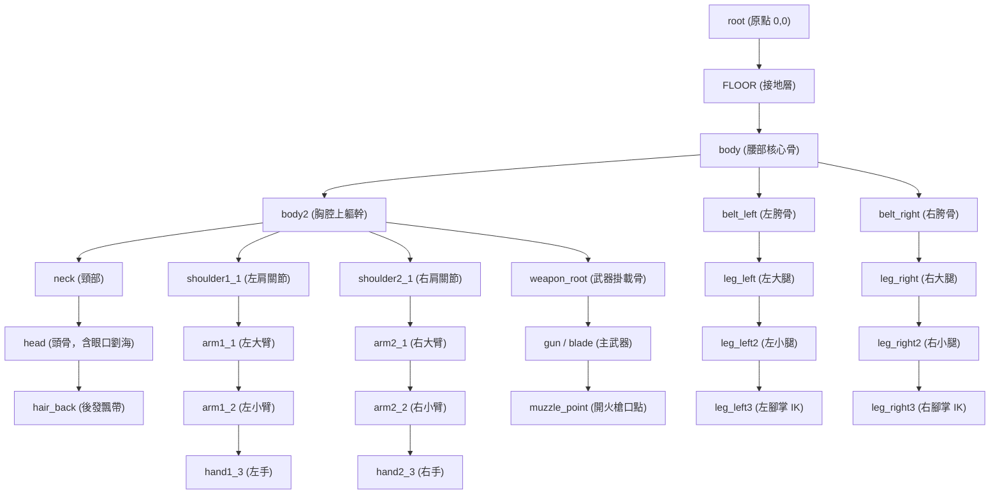
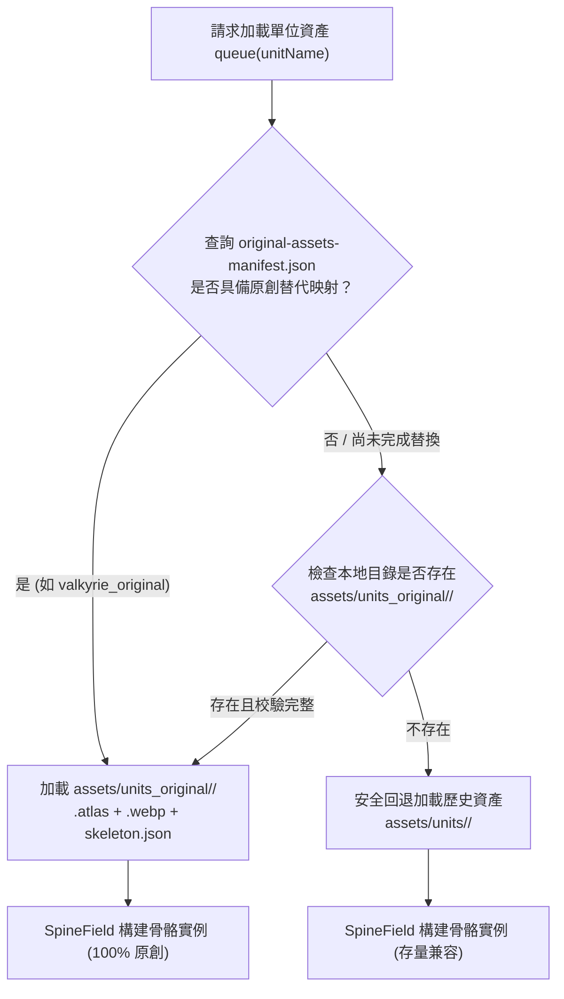

# 自研原創資產替換管線技術規範標準書
# Original Asset Replacement Pipeline Specification (v1.0)

> **生效日期**：2026-11-02  
> **編制機構**：項目架構與美術工程聯合技術委員會  
> **適用範圍**：Lust Goddess 本地復刻版（單機戰術版）全量特勤角色、敵人單位、視覺立繪與 Spine 2D 骨骼動畫生產管線  
> **交付語文**：香港繁體（PingFang HK）

---

## 第一章 總則與法律確權標準

### 1.1 宗旨與管線目標
為徹底消除項目現存歷史遺留的第三方逆向提取資源（包含 55 名英雄與 168 類敵人的骨骼與貼圖），落實商業發行合規標準，特制定本自研原創資產替換管線（下稱「本管線」）。本管線旨在構建一套**標準化、工業化、可回歸、可自動化打包驗證**的原創資產交付體系，實現全量立繪與骨骼資產的 100% 獨立版權自有化。

### 1.2 版權與法務紅線
1. **零外部污染原則**：嚴禁任何逆向工程反編譯資源、提取圖集切片或未授權字型混入原創資產發行目錄（`web/assets/units_original/` 及 `web/assets/heroes_original/`）。
2. **純淨確權流程**：所有原創角色立繪、線稿、部件切片與 Spine 工程文件，必須具備完整的創作過程文件（源工程檔、PSD 分層檔、Spine `.spine` 項目檔及生成審計記錄）。
3. **交付格式標準化**：所有入庫資產必須通過自動化校驗器（`tools/original_asset_pipeline.py validate-unit`）審計，杜絕格式畸變或屬性缺失。

---

## 第二章 高精矢量與數字立繪美術規範

### 2.1 畫布尺寸與色彩配置
所有角色原創立繪必須遵循以下工業級標準：

| 資源類別 | 畫布分辨率 (px) | 渲染輸出格式 | 色彩空間 | Alpha 通道 | 最小對比度 (WCAG) |
|---|---|---|---|---|---|
| **旗艦大立繪 (Base Art)** | $2048 \times 2048$ (或 $1536 \times 2400$) | WebP (品質 92, PMA) | Display P3 / sRGB | 8-bit 透明度 (0-255) | $\ge 4.5:1$ (暗色背景) |
| **動態抽卡展示 (Lega Art)** | $2048 \times 2048$ | WebP (品質 90, PMA) | Display P3 / sRGB | 8-bit 透明度 | $\ge 4.5:1$ |
| **預覽縮略圖 (Thumbnails)** | $512 \times 512$ (基線 $300 \times 400$) | WebP (品質 85, 無損) | sRGB | 8-bit 透明度 | $\ge 4.5:1$ |
| **UI 戰術頭像 (Avatar)** | $256 \times 256$ | WebP (品質 85, 無損) | sRGB | 8-bit 透明度 | $\ge 4.5:1$ |

### 2.2 賽博龐克戰術美學風格標準
1. **Apple HIG 擬物玻璃與科幻融合**：
   - 角色服飾與戰術外骨骼採用消光黑曜石合金、高純白陶瓷裝甲、半透明磨砂聚合物與微光霓虹電路（Cyan `#00f3ff`、Magenta `#ff0055`、Amber `#ffd700`）。
   - 視覺層級需滿足 390 寬度手機屏幕下的清晰輪廓辨識，外形輪廓線寬度保持 2~3 px 銳利抗鋸齒。
2. **立繪動態姿態要求**：
   - 角色立繪需保持正面微側 15°~20° 站姿，重心穩定，適配戰術戰場三路網格以及大廳 76% 縱向占屏比例。
   - 關鍵發絲與披風、吊帶保留自然重力垂墜與空氣流動感，便於二維骨骼綁定。

### 2.3 拆件分層規範（PSD / PNG 分層包）
為支撐 Spine 2D 骨骼高自由度運動，高精立繪必須按以下 9 大核心圖層組進行精細拆解與邊緣羽化補全（補色寬度 $\ge 12\text{ px}$，避免骨骼旋轉時穿幫露白）：

```
[Layer Root]
├── 01_VFX_Front (前景光效、槍口火光、以太粒子)
├── 02_Weapon (主武器：戰術突擊步槍 / 能量刃 / 重砲，獨立拆出彈匣與瞄準鏡)
├── 03_Arm_Right (右手掌、右小臂、右大臂、護肩)
├── 04_Head_Group
│   ├── Hair_Front (前劉海、呆毛、鬢角)
│   ├── Face_Features (眉毛、高光眼眸、閉眼態、微張口、通訊耳機)
│   ├── Face_Base (臉部肌膚底層)
│   └── Hair_Back (後發、發梢馬尾)
├── 05_Torso_Group
│   ├── Armor_Chest (胸甲、戰術背心、呼吸燈)
│   ├── Body_Upper (胸部、頸部)
│   └── Body_Lower (腰部、戰術腰帶、彈藥包)
├── 06_Arm_Left (左手掌、左小臂、左大臂、副護肩)
├── 07_Leg_Right (右靴、右小腿、右大腿、戰術護膝)
├── 08_Leg_Left (左靴、左小腿、左大腿、戰術護膝)
└── 09_VFX_Back (背光光環、披風後擺、浮游武裝)
```

---

## 第三章 Spine 2D 骨骼動畫工業標準

### 3.1 運行時協議契約
- **運行時版本**：**Spine 4.2.xx**（嚴格匹配 `web/js/spine.js` 之 `spine.SkeletonJson` 與 `spine.ManagedWebGLRenderingContext`）。
- **數據協議格式**：JSON 結構（`skeleton.json`），包含 `skeleton` 元數據、`bones` 骨骼清單、`slots` 槽位清單、`skins` 圖層附加物、`animations` 動畫剪輯。
- **單位坐標系**：
  - 世界原點 $(0, 0)$ 為角色腳底接地中心點；
  - 骨骼長度與位置單位為像素（基準設計高度為 $900\text{ px} \sim 1100\text{ px}$）；
  - `y` 軸向上為正，`x` 轴向右為正。

### 3.2 標準骨骼拓撲層級架構
所有自研人形角色必須統一遵循標準骨骼層級命名，以確保戰場邏輯腳本（`web/js/battle.js`、`web/js/intro.js`）能夠精確索引用於受擊震屏、特效掛載與坐標投影：



### 3.3 必備原生骨骼動作清單（Native Spine Tracks）
每個角色必須具備至少 4 套原生動態骨骼剪輯，嚴禁空缺：

| 動畫名稱 (Clip ID) | 循環標誌 (Loop) | 推薦時長 (s) | 關鍵動力學曲線與幀表現要求 | 戰鬥引擎調用點 |
|---|---|---|---|---|
| `idle` | `true` | 1.8 ~ 2.4 | 待機律動。包含胸腔呼吸起伏（Scale Y 1.0~1.03）、頭部微仰、武器待機懸停、發絲輕微正弦波飄動。 | 大廳看板、戰場站位、關卡待機 |
| `damage` | `false` | 0.35 ~ 0.5 | 受擊硬直。角色身體受力後撤（X 軸偏移 $-15\sim -25\text{ px}$），腰部微屈，發絲向前過衝回彈。 | 受到普通攻擊、技能受創、防禦崩解 |
| `hit` | `false` | 0.45 ~ 0.6 | 近戰刺擊/橫斬。身體前傾突進（X 軸 $+20\sim +35\text{ px}$），手臂快速揮擊（0.12s 達打擊點），刀光軌跡浮現。 | 近戰特勤普攻、突刺戰技 |
| `rangehit` | `false` | 0.5 ~ 0.7 | 遠程射擊。武器抬起鎖定目標，槍機後座力震動（後退 $8\text{ px}$，0.06s 內復位），槍口火光播放。 | 遠程特勤普攻、精準狙擊 |

### 3.4 混合合成動作規範（Synthetic Fallback）
遵循 `web/data/animation-manifest.json` 定義的 5 大合成狀態：
1. `wake`：暗場微弱呼吸律動 + 視口模糊由 $10\text{ px} \to 0\text{ px}$；
2. `enter`：骨骼橫向滑入（xRatio $0.5 \to$ 目標位）+ 粒子光環爆發；
3. `talk`：Spine 骨骼配合 1.02x 周期縮放 + 通訊波紋光斑；
4. `react`：調用 `damage` 首幀硬直 + 警報雷達鎖定標記；
5. `victory`：調用 `idle` 骨骼疊加勝者躍動縮放（$1.0 \to 1.08$）+ 勝利金輝粒子爆裂。

---

## 第四章 紋理圖集（Texture Atlas）打包與 WebP 壓製

### 4.1 圖集參數契約
- **圖集描述文件**：`<unit_name>.atlas`（LibGDX / Spine 4.2 標準格式）。
- **貼圖文件**：`<unit_name>.webp`（禁止外掛散圖，單一單位打包為一張貼圖）。
- **過濾模式**：`filter: Linear,Linear`。
- **預乘透明度**：`pma: true`（消除 WebGL 渲染時 Alpha 邊緣黑邊或白邊瑕疵）。
- **貼圖尺寸**：優先採用二次方（Power of Two，POT），如 $512 \times 512$、$1024 \times 1024$ 或 $2048 \times 2048$。

### 4.2 LibGDX Atlas 語法結構標準
```text
valkyrie_original.webp
size: 1024,1024
format: RGBA8888
filter: Linear,Linear
repeat: none
pma: true
scale: 1.0
body
  bounds: 12, 18, 180, 240
head
  bounds: 210, 18, 160, 190
arm_left
  bounds: 390, 18, 90, 140
```

---

## 第五章 雙軌漸進式替換架構（Dual-Track Resolution）

### 5.1 雙軌加載機制設計
為確保替換過程中游戲運行時零中斷、1000 場戰鬥確定性測試零回歸，項目採用**雙軌資產解析引擎（Asset Resolver）**：



### 5.2 資產註冊清單數據契約
清單路徑：[`web/data/original-assets-manifest.json`](file:///Users/itou/Documents/project-hgame/web/data/original-assets-manifest.json)
```json
{
  "version": "1.0",
  "generatedAt": "2026-11-02T10:45:00+08:00",
  "pipelineVersion": "original-pipeline-v1",
  "units": {
    "valkyrie_original": {
      "key": "valkyrie",
      "name": "女武神·瓦爾基麗",
      "unit": "valkyrie_original",
      "class": "melee",
      "race": "order",
      "atlas": "assets/units_original/valkyrie_original/valkyrie_original.atlas",
      "webp": "assets/units_original/valkyrie_original/valkyrie_original.webp",
      "skeleton": "assets/units_original/valkyrie_original/skeleton.json",
      "artWeb": {
        "base": "assets/heroes_original/valkyrie/base.webp",
        "lega": "assets/heroes_original/valkyrie/lega.webp",
        "thumb": "assets/heroes_original/valkyrie/thumb.webp"
      },
      "verified": true
    }
  },
  "unitOverrides": {
    "kitty_player": "valkyrie_original"
  }
}
```

---

## 第六章 特勤替換梯隊排期矩陣（Replacement Matrix）

| 批次階段 | 目標對象 | 涵蓋角色與單位數 | 交付內容 | 驗收標準 |
|---|---|---|---|---|
| **Tier 1 (旗艦核心)** | 5 大主力英雄 (Kitty、Dominica、Regina、Justina、Esther) | 5 個特勤單元 + 2 個首領 (Lucretia, Lilith) | 2048 立繪、Spine 4.2 骨骼 (4 動作)、高精 WebP 圖集、序章雙角色演繹 | 骨骼動畫零報錯、1000 次固定種子回放逐位一致 |
| **Tier 2 (主力特勤)** | 秩序/混沌/自然核心 SSR 特勤 (Zoe、Arachne、Mitsuki、Freya 等) | 20 個特勤單元 | 1024/2048 立繪、Spine 骨骼、詳情頁霓虹共鳴徽章 | 技能動作完整匹配、套裝裝備掛載正常 |
| **Tier 3 (常規英雄)** | 剩餘 R/SR 特勤單位 | 30 個特勤單元 | 標準立繪、Spine 骨骼、三態 WebP 圖集 | 戰鬥流暢無內存泄漏、資源尺寸受控 |
| **Tier 4 (敵軍兵種)** | 戰術無人機、黑幫暴徒、沙海沙蟲、王座守衛 | 168 類敵軍單位 | 怪物骨骼、打擊硬直動畫、受擊粒子 | 批量產出、單元圖集 $\le 512\text{ KB}$ |

---

## 第七章 自動化工程工具鏈指令手冊

項目集成自動化管線工具 [`tools/original_asset_pipeline.py`](file:///Users/itou/Documents/project-hgame/tools/original_asset_pipeline.py)：

### 7.1 初始化角色腳手架
```sh
.venv-assets/bin/python tools/original_asset_pipeline.py init-unit valkyrie_original \
  --name "女武神·瓦爾基麗" \
  --class melee \
  --race order
```

### 7.2 部件圖集排樣與 WebP 壓製
```sh
.venv-assets/bin/python tools/original_asset_pipeline.py pack-atlas \
  --parts-dir raw_art/valkyrie/parts \
  --output-dir web/assets/units_original/valkyrie_original \
  --name valkyrie_original \
  --size 1024
```

### 7.3 Spine 4.2 骨骼與動作構建
```sh
.venv-assets/bin/python tools/original_asset_pipeline.py build-skeleton \
  --config raw_art/valkyrie/skeleton_config.json \
  --output web/assets/units_original/valkyrie_original/skeleton.json
```

### 7.4 工業完整性校驗（CI/CD 門禁）
```sh
.venv-assets/bin/python tools/original_asset_pipeline.py validate-unit \
  --unit-dir web/assets/units_original/valkyrie_original
```

---

## 第八章 結語
本規範是項目後續全面擺脫第三方商業版權依賴的法定綱領文件。自發布之日起，所有新建與替換角色必須 100% 遵照本標準執行。
